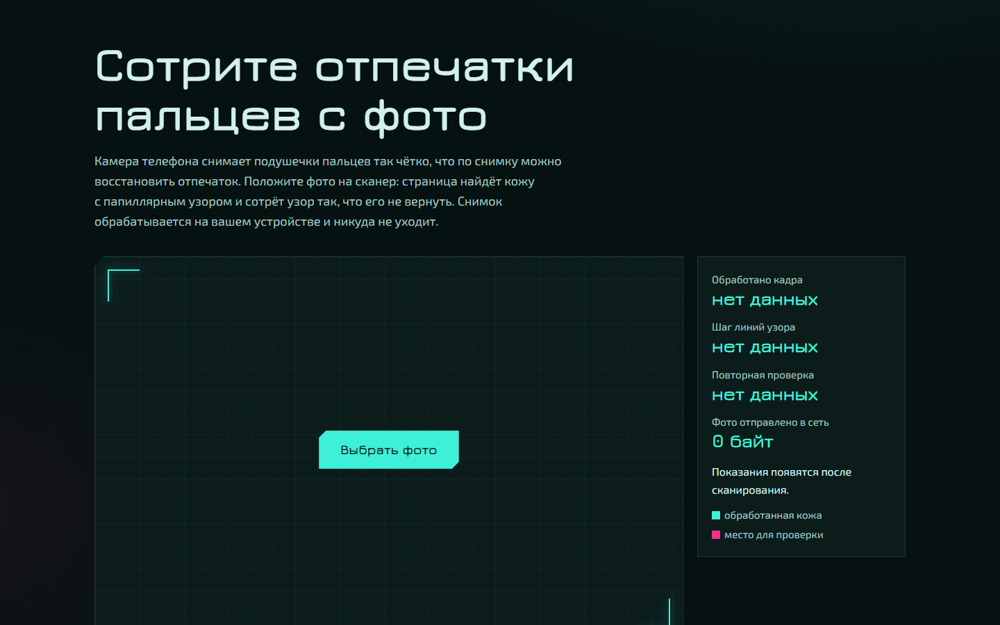

# Без отпечатков

Страница для браузера, которая находит на фото кожу с папиллярным узором (пальцы, ладони) и стирает узор так, что его нельзя восстановить. Фото обрабатывается на вашем устройстве и никуда не отправляется: страница запрещает себе сетевые запросы политикой безопасности (CSP), её можно проверить во вкладке Network.

*Browser tool that removes fingerprint ridges from photos before you post them. Runs fully offline in the browser, nothing is uploaded.*



## Зачем

Камера современного телефона снимает подушечки пальцев так чётко, что по обычному снимку можно восстановить отпечаток. На снимке Samsung Galaxy S24 FE с полуметра программа для сравнения отпечатков SourceAFIS узнаёт палец с оценкой 263 при пороге совпадения 40. Простое размытие не спасает: после повышения резкости оценка возвращается к 215.

## Насколько это работает

Проверка SourceAFIS, порог совпадения 40, у чужого пальца около 5:

| Снимок | Оригинал | После страницы | После атак на результат |
|---|---|---|---|
| Мизинец, Galaxy S24 FE | 263 | 0 | 0-2,2 |
| Макро подушечки, Wikimedia Commons | 52 | 0,7 | 0-1,5 |
| Большой палец на ладони, Wikimedia Commons | 138 | 1,4 | 0-4,8 |

Атаки: повышение резкости, фильтр Винера, который знает размытие, и выравнивание контраста. Дополнительно страница прогнана на 19 фото рук из Wikimedia Commons: светлая и тёмная кожа, толпа, перчатки, макро, дерево и ткань без людей. Подробности в [docs/research](docs/research).

## Как это устроено

1. Нейросеть MediaPipe находит кожу. Она смотрит на весь кадр и на перекрывающиеся куски, поэтому замечает и мелкие руки, и крупный план пальца.
2. По всему кадру ищутся плитки с ровными параллельными полосами нужного шага, как у папиллярного узора. Плитка с узором обрабатывается, даже если нейросеть не узнала там кожу.
3. Детали мельче примерно трёх линий узора стираются полностью, сверху ложится мелкое зерно. Размытие подбирается по шагу линий в каждом месте: палец ближе к камере получает более сильное.
4. Результат проверяется ещё раз. Если полосы остались, страница дочищает их и отмечает на карте.
5. Файл собирается заново из пикселей: EXIF, геометка, миниатюра оригинала и вложенное видео Motion Photo не переносятся.

Почему стёртое нельзя вернуть: сильное размытие ослабляет линии узора примерно в 500 миллионов раз, это меньше одного шага яркости в 8-битном файле. После округления от узора остаётся ноль.

## Ограничения

- Защищён только обработанный файл. Оригинал в галерее и облаке остаётся.
- Если узор не нашёлся ни нейросетью, ни поиском полос, он останется. Перед публикацией посмотрите карту.
- Полосатые дерево, ткань или татуировка рядом с рукой тоже сглаживаются. Полосы вдали от кожи можно вернуть одной кнопкой.
- Лицо и другая биометрия не обрабатываются.
- На iPhone снимки больше 16 Мп уменьшаются: Safari не обрабатывает кадры крупнее. Нужен Safari 16.4 или новее.
- HEIC открывается не во всех браузерах.

## Устройство репозитория

- `web/` сама страница без сборки: `index.html`, `app.js` (модель кожи), `worker.js` (фоновый поток), `lib/core.js` (вся обработка).
- `dev/` инструменты разработчика: эталон на Python (`scrub.py`), прогон ядра через Node (`js_check.py`), атаки (`attack.py`), сравнение SourceAFIS (`afis/`, C#), локальный сервер (`serve.py`).
- `docs/` план, исследования, замеры, технический аудит.

## Запуск у себя

```bash
python dev/serve.py
```

Затем открыть http://127.0.0.1:8765/web/index.html.

## Лицензии

Код: MIT. MediaPipe Tasks Vision и модель SelfieMulticlass: Apache 2.0 (Google). Шрифты Jura и Exo 2: SIL Open Font License, файлы лицензий в `web/fonts`.
